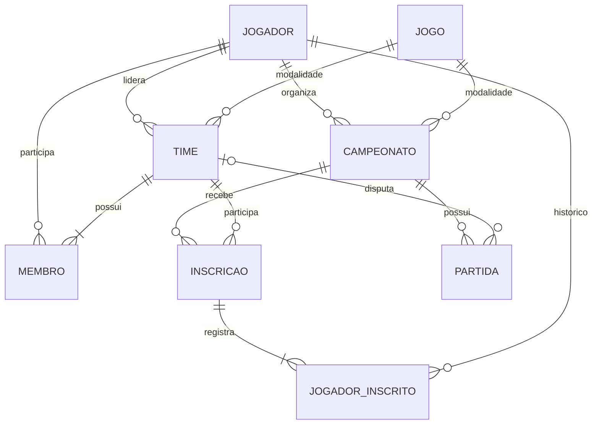
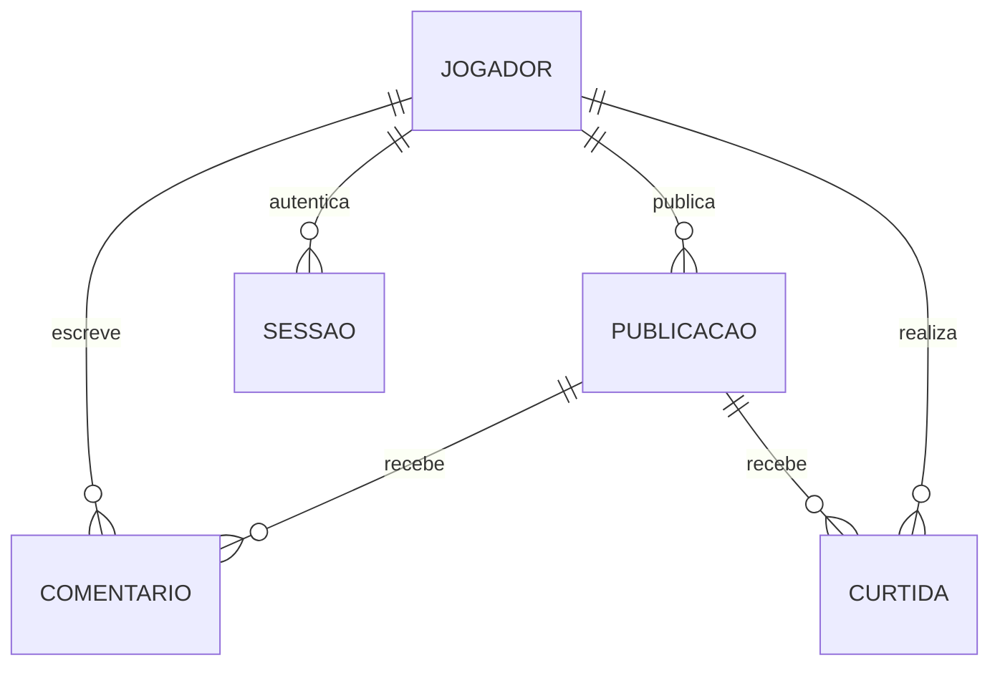

# Modelagem do banco de dados

## 1. Conceitual

Entidades centrais: jogador, jogo, time, campeonato, inscrição, partida, publicação e comentário. Curtida, membro e jogador da inscrição representam associações. Sessões e migrations são entidades técnicas.



O relacionamento TIME/PARTIDA representa as duas posições e o vencedor opcionais até a classificação. Participação é N:N entre jogadores e times; inscrição é N:N entre times e campeonatos. Um jogador inscrito precisa pertencer ao time naquele momento.



## 2. Lógica

Todas as chaves `id` são INTEGER PRIMARY KEY. Timestamps são TEXT em UTC, exceto `sessions.expires_at`, que guarda milissegundos desde epoch. Campos opcionais são indicados; demais são NOT NULL ou possuem default conforme SQL.

| Tabela               | Atributos                                                                                                                                                                                      | Restrições e relações                                                                                   |
| -------------------- | ---------------------------------------------------------------------------------------------------------------------------------------------------------------------------------------------- | ------------------------------------------------------------------------------------------------------- |
| users                | id, username, email, password_hash, name, bio, region, created_at                                                                                                                              | username e email UNIQUE COLLATE NOCASE                                                                  |
| sessions             | token_hash, user_id, expires_at                                                                                                                                                                | PK token_hash; FK users, CASCADE                                                                        |
| games                | id, name, genre, description, platforms, owner_id opcional                                                                                                                                     | name UNIQUE; owner_id FK users; nulo para catálogo inicial                                              |
| teams                | id, name, game_id, captain_id, description                                                                                                                                                     | name UNIQUE; FKs games e users                                                                          |
| team_members         | team_id, user_id                                                                                                                                                                               | PK composta; FKs teams/users, CASCADE                                                                   |
| tournaments          | id, name, game_id, owner_id, capacity, team_size, starts_at, status, created_at                                                                                                                | FKs games/users; CHECK capacidade 2–64; elenco 1–8; status open/running/finished                        |
| registrations        | id, tournament_id, team_id, created_at                                                                                                                                                         | UNIQUE campeonato+time; FK tournaments CASCADE; FK teams restritiva                                     |
| registration_players | registration_id, user_id                                                                                                                                                                       | PK composta; FK registrations CASCADE; FK users restritiva                                              |
| matches              | id, tournament_id, round, position, team_a opcional, team_b opcional, score_a opcional, score_b opcional, winner_id opcional, status, scheduled_at opcional, stream_url, completed_at opcional | UNIQUE campeonato+rodada+posição; FK tournaments CASCADE; três FKs teams; status waiting/ready/done/bye |
| posts                | id, user_id, text, created_at                                                                                                                                                                  | FK users CASCADE                                                                                        |
| likes                | post_id, user_id                                                                                                                                                                               | PK composta; FKs posts/users CASCADE                                                                    |
| comments             | id, post_id, user_id, text, created_at                                                                                                                                                         | FKs posts/users CASCADE                                                                                 |
| migrations           | name, applied_at                                                                                                                                                                               | PK name; controle técnico                                                                               |

### Dependências e normalização

Atributos de jogador e jogo não são repetidos em times, campeonatos ou publicações; as consultas usam JOIN. Associações N:N são tabelas com chave composta ou unicidade explícita. Estatísticas e ranking são consultas derivadas, evitando saldos inconsistentes. Contagem de inscritos/curtidas/comentários também é derivada.

`registration_players` não duplica arbitrariamente o elenco atual: representa o fato histórico “jogador registrado nesta inscrição”, distinto de “membro atual deste time”. Assim a mudança posterior do elenco não muda o resultado antigo. Rodada e posição determinam a estrutura da árvore; nomes dos times não são gravados em partidas.

Capitão deve pertencer ao elenco, um jogador só participa uma vez por campeonato, placar não pode empatar e a capacidade não pode ser ultrapassada: são invariantes conferidos pela API. As transações `BEGIN IMMEDIATE` mantêm atomicidade das inscrições e da geração/resultados da chave. Não é permitido acesso de escrita direto ao banco durante uso normal.

## 3. Física

O acesso ao SQLite usa `better-sqlite3` 12.4.1, compatível com Node.js 20. O formato do banco permanece SQLite; nenhuma migration de conversão é necessária nesta atualização.

O DDL real está em `db/migrations/001_initial.sql` e `002_catalog_and_audit.sql`. A aplicação cria `migrations`, aplica arquivos em ordem e registra cada nome na mesma transação do DDL. Execute `npm run db:migrate` ou inicie o servidor. SQL usa os recursos do SQLite; não é um script compatível sem adaptação com MySQL/PostgreSQL.

Configurações: `PRAGMA foreign_keys=ON`, journal WAL e busy_timeout de 5.000 ms. Índices adicionais atendem busca de partidas por campeonato/rodada/posição, jogadores de inscrições, inscrições de time, membros de usuário e comentários de post. PKs e restrições UNIQUE já criam índices para os acessos correspondentes.

Exemplo de consulta de participantes:

```sql
SELECT t.name AS campeonato, tm.name AS time, u.username AS jogador
FROM tournaments t
JOIN registrations r ON r.tournament_id = t.id
JOIN teams tm ON tm.id = r.team_id
JOIN registration_players rp ON rp.registration_id = r.id
JOIN users u ON u.id = rp.user_id
ORDER BY t.id, tm.id, u.id;
```

O banco é criado localmente ao executar o projeto e não acompanha contas reais no ZIP. O seed oferece catálogo inicial idempotente e dados demo apenas quando explicitamente habilitados.
